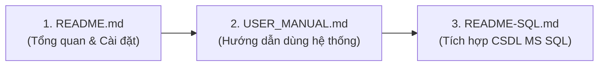

# 🎓 LINGUAHUB — HỆ THỐNG QUẢN LÝ TRUNG TÂM NGOẠI NGỮ TÍCH HỢP AI

> **Hệ thống Quản lý Đào tạo và Hỗ trợ Học tập Thông minh** được xây dựng trên nền tảng **Node.js (Express)**, **Vanilla JS/HTML/CSS**, **MS SQL Server** và **Trí tuệ nhân tạo (AI)**.

[](https://nodejs.org/)
[](https://expressjs.com/)
[]()
[]()
[](LICENSE)

---

## 🧭 LỘ TRÌNH ĐỌC TÀI LIỆU (READING ROADMAP)

Để thuận tiện nhất cho việc trải nghiệm và tìm hiểu dự án, hãy đọc các tài liệu theo thứ tự khuyến nghị dưới đây:



1. 🎯 **Bước 1 — Xem Tổng Quan (File đang mở)**: Tìm hiểu tính năng, cấu trúc thư mục và cách khởi chạy server chỉ với 1 cú click.
2. 👨‍🏫 **Bước 2 — Trải nghiệm Hệ thống**: Đọc **USER_MANUAL.md** (tài liệu được tự động tạo trước đó) để biết chi tiết cách thao tác của Học viên, Giảng viên và Quản trị viên.
3. 🗄️ **Bước 3 — Mở rộng Cơ sở dữ liệu**: Đọc **[README-SQL.md](README-SQL.md)** nếu bạn muốn chuyển đổi từ In-Memory Database (mặc định) sang MS SQL Server thực tế.

---

## 📑 BẢNG MỤC LỤC HỒ SƠ ĐỒ ÁN MÔN HỌC (ACADEMIC DELIVERABLES)

| Tài liệu | Đối tượng & Mục đích (Chuẩn đầu ra môn học) |
|---|---|
| 📘 [**BAO_CAO_KY_THUAT.md**](docs/BAO_CAO_KY_THUAT.md) | **Báo cáo Kỹ thuật Đồ án hoàn chỉnh**: Đặt vấn đề, khảo sát nghiệp vụ, kiến trúc hệ thống, CSDL, kỹ thuật Prompt Engineering, thực nghiệm và kết luận (CLO1 - CLO5, PLO7). |
| 🔬 [**PROMPT_EVALUATION.md**](docs/PROMPT_EVALUATION.md) | **Bảng thực nghiệm so sánh Prompt**: Đánh giá đối chứng Prompt v1 (Zero-shot), Prompt v2 (Role-only), Prompt v3 (RAG Grounding + Guardrails) qua 15 benchmark queries (CLO3, CLO5). |
| 🧪 [**TEST_CASES.md**](docs/TEST_CASES.md) | **Kịch bản kiểm thử toàn diện**: 29 ca kiểm thử (Ca đúng, ca sai, ca giá trị biên, ca chịu lỗi và phục hồi hệ thống AI) (CLO3, CLO4, CLO5). |
| 🧠 [**AI_SDLC_EVIDENCE.md**](docs/AI_SDLC_EVIDENCE.md) | **Minh chứng AI trong SDLC & Tư duy phản biện**: Nhật ký ứng dụng AI xuyên suốt 5 giai đoạn phát triển + Bảng kiểm chứng sửa lỗi sai do AI sinh ra (CLO1, CLO2, CLO5). |
| 📖 [**USER_MANUAL.md**](USER_MANUAL.md) | **Hướng dẫn sử dụng chi tiết A-Z**: Thao tác từng bước trên giao diện cho 3 phân hệ (Admin, Giáo viên, Học viên) và cách trò chuyện với AI. |
| 🗄️ [**README-SQL.md**](README-SQL.md) | **Hướng dẫn thiết lập SQL Server**: Các bước import file `.sql`, khai báo biến môi trường trong `.env` để kết nối với cơ sở dữ liệu thật. |

---

## ✨ TÍNH NĂNG NỔI BẬT

### 1. 📊 Phân Hệ Quản Lý Đào Tạo Chuyên Biệt
* **Học viên (Student)**: Xem danh sách lớp đang tham gia, theo dõi lịch sử điểm danh và tra cứu điểm số các bài thi.
* **Giảng viên (Teacher)**: Quản lý danh sách lớp được phân công, thực hiện điểm danh học viên và nhập/chỉnh sửa điểm thi trực tiếp.
* **Quản trị viên (Admin)**: Thống kê tổng quan, quản lý hồ sơ người dùng (Cấp quyền, Đổi trạng thái), mở khóa học mới và phân bổ giảng viên.

### 2. 🤖 Trợ Lý AI Tích Hợp Sâu (Role-Based AI)
* Khác với các chatbot thông thường, AI trong LinguaHub được cấu hình "hiểu" rõ người đang trò chuyện là ai (Học viên hay Giáo viên).
* **Học viên**: AI tự động trích xuất điểm số, số ngày vắng mặt để báo cáo trực tiếp khi được hỏi (VD: "Tôi đang học lớp nào?", "Điểm tôi ra sao?").
* **Giáo viên**: AI hỗ trợ liệt kê nhanh danh sách lớp đang phụ trách và cung cấp thông tin quản lý.

### 3. ⚙️ Cơ Chế Vận Hành Thông Minh & Thân Thiện
* **Start-Server Tự Động**: Dự án đi kèm script `start-server.bat` tự động phát hiện, cài đặt Node.js Portable (nếu thiếu) và cài đặt `node_modules` giúp bất kỳ ai cũng có thể chạy dự án bằng một cú đúp chuột.
* **Fallback Database**: Tích hợp sẵn cơ chế In-Memory Database (chứa dữ liệu demo chi tiết 6 tháng) giúp ứng dụng luôn chạy mượt mà ngay cả khi không cấu hình MS SQL.
* **Giao Diện Hợp Nhất**: Form đăng nhập/đăng ký giao diện hiện đại, dùng chung cho mọi vai trò, hệ thống tự điều hướng trang đích dựa trên Role của tài khoản.

---

## 🏗️ CẤU TRÚC THƯ MỤC DỰ ÁN

```text
linguahub/
├── 🌐 frontend/                # [FRONTEND] Giao diện người dùng thuần túy (HTML, CSS, JS)
│   ├── css/                    # Hệ thống định dạng (style.css, auth.css, login.css)
│   ├── js/                     # Client logic (auth.js, login.js, ai-service.js...)
│   ├── assets/                 # Hình ảnh và logo
│   └── *.html                  # Các trang (index, login, admin, teacher, student...)
│
├── ⚙️ backend/                 # [BACKEND] Máy chủ Node.js & Express
│   ├── server.js               # Điểm vào chính: Chứa logic Routing, Middleware, In-Memory DB
│   ├── app.js                  # Script logic bổ trợ
│   ├── .env                    # Lưu trữ cấu hình kết nối MS SQL & Ports
│   └── package.json            # Quản lý các packages (express, mssql, cors...)
│
├── 🗄️ database/                # [DATABASE] Dữ liệu và Scripts SQL
│   └── sql-server-setup.sql    # DDL script để khởi tạo toàn bộ bảng trong SQL Server
│
├── 🔧 scripts/                 # [AUTOMATION] Công cụ tự động hóa triển khai
│   └── start-server.bat        # Batch file thông minh cài Node.js Portable & khởi động server
│
└── 📖 docs/                    # [DOCS] Toàn bộ tài liệu hướng dẫn
    ├── USER_MANUAL.md          # Hướng dẫn thao tác nghiệp vụ
    ├── README-SQL.md           # Hướng dẫn quản trị và migration CSDL
    └── README.md               # File này
```

---

## 🚀 HƯỚNG DẪN CÀI ĐẶT & CHẠY DỰ ÁN (QUICK START)

LinguaHub được tối ưu hóa để chạy ngay lập tức mà không đòi hỏi thao tác cấu hình phức tạp từ người tải.

### Bước 1: Khởi động Máy chủ Tự động
1. Giải nén dự án hoặc clone từ GitHub.
2. Tìm và **Click đúp chuột** vào file **`start-server.bat`** tại thư mục gốc.
3. Kịch bản thông minh sẽ thực hiện:
   * Tự động quét và tải Node.js bản Portable (nếu máy bạn chưa có).
   * Tự động chạy lệnh `npm install` để tải thư viện.
   * Bật máy chủ backend và thông báo sẵn sàng tại `http://localhost:3000`.

### Bước 2: Đăng nhập Trải nghiệm
Sau khi terminal báo dòng chữ xanh "Server running...", hãy giữ nguyên cửa sổ terminal đó và mở trình duyệt web, truy cập:
👉 **`http://localhost:3000/login.html`**

*(Hệ thống đã có sẵn dữ liệu mẫu cho mọi vai trò mà không cần cấu hình SQL)*.

---

## 🔑 THÔNG TIN ĐĂNG NHẬP TÀI KHOẢN DEMO

Bạn có thể dùng các tài khoản có sẵn dưới đây để kiểm tra hệ thống:

| Vai Trò | Username | Email | Mật khẩu | Chức năng nổi bật |
|---|---|---|---|---|
| **Quản trị viên** | `admin` | `admin@linguahub.local` | `123456` | Bảng điều khiển, Quản lý tài khoản |
| **Giảng viên** | `lan` | `lan@linguahub.local` | `123456` | Điểm danh, nhập điểm, hỏi AI lớp dạy |
| **Giảng viên** | `hung` | `hung@linguahub.local` | `123456` | Điểm danh, nhập điểm, hỏi AI lớp dạy |
| **Học viên** | `nguyenvana` | `nguyenvana@linguahub.local` | `123456` | Xem điểm, điểm danh, hỏi AI lịch học |

---

## 🛡️ BẢO MẬT & BẢN QUYỀN

* Xác thực và kiểm soát quyền truy cập trang được quản lý thông qua **Cơ chế Token/Session**.
* Phân luồng bảo vệ truy cập Public API và Protected API bằng Express Middleware.
* Dự án là sản phẩm được lưu hành tuân thủ quy định chuẩn giáo dục/open-source.
