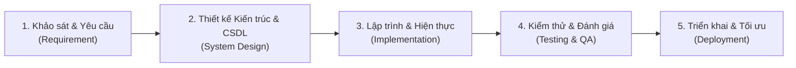

# 🧠 MINH CHỨNG ỨNG DỤNG AI TRONG SDLC & TƯ DUY PHẢN BIỆN
## HỌC PHẦN: ỨNG DỤNG TRÍ TUỆ NHÂN TẠO (ICTU)
**Dự án:** Hệ thống Quản lý Trung tâm Ngoại ngữ LinguaHub Tích hợp Generative AI  
**Tiêu chí đáp ứng:** Tiêu chí 5.1 (Minh chứng AI trong SDLC), 5.2 (Kiểm chứng, sửa lỗi AI), 5.4 (Cải tiến, đóng góp riêng)  
**Chuẩn đầu ra:** CLO1, CLO2, CLO5  

---

## 1. MINH CHỨNG ỨNG DỤNG TRÍ TUỆ NHÂN TẠO TRONG VÒNG ĐỜI PHÁT TRIỂN PHẦN MỀM (AI IN SDLC)

Trong suốt quá trình thực hiện đồ án LinguaHub, nhóm đã ứng dụng các công cụ AI Tạo sinh (Generative AI) như Google Gemini, ChatGPT và AI Pair-Programming Assistant vào từng giai đoạn của vòng đời phát triển phần mềm (SDLC) theo đúng chuẩn đầu ra **CLO2**:

### 1.1 Giai đoạn 1: Khảo sát và Phân tích Yêu cầu (Requirement Analysis)
* **Mục tiêu:** Xác định đầy đủ các ca sử dụng (Use Cases) cho một trung tâm ngoại ngữ hiện đại và xác định vị trí cốt lõi cần tích hợp AI.
* **Prompt mẫu đã sử dụng:**
  > *"Hãy đóng vai Chuyên gia Phân tích Nghiệp vụ Phần mềm (BA). Tôi muốn xây dựng một hệ thống quản lý trung tâm ngoại ngữ gồm 3 phân hệ: Quản trị viên, Giảng viên và Học viên. Hãy liệt kê các chức năng cốt lõi và đề xuất giải pháp ứng dụng Trí tuệ nhân tạo tạo sinh (GenAI) để giải quyết bài toán chăm sóc học viên và hỗ trợ sư phạm mà các phần mềm CRUD truyền thống chưa làm được."*
* **Giá trị AI đem lại:** AI đã gợi ý phân tách rõ 3 vai trò trợ lý: Cố vấn điều hành cho Admin, Trợ lý sư phạm cho Giáo viên, và Gia sư học tập cá nhân cho Học viên.

### 1.2 Giai đoạn 2: Thiết kế Kiến trúc và Cơ sở Dữ liệu (System & Database Design)
* **Mục tiêu:** Thiết kế mô hình dữ liệu quan hệ (Relational Schema) trên MS SQL Server và giải pháp kiến trúc RAG Grounding.
* **Prompt mẫu đã sử dụng:**
  > *"Hãy tạo script DDL SQL Server cho hệ thống quản lý trung tâm ngoại ngữ gồm các bảng: Users, Teachers, Students, Classes, ClassStudents, Attendance, Scores. Đảm bảo có đầy đủ khóa chính IDENTITY, khóa ngoại liên kết toàn vẹn tham chiếu, các chỉ mục (INDEX) trên UserId, ClassId và các giá trị mặc định cho ngày tháng."*
* **Giá trị AI đem lại:** Sinh ra bộ khung DDL chuẩn cho file [sql-server-setup.sql](file:///e:/Downloads/QuanLyTTNN/sql-server-setup.sql) với cấu trúc quan hệ chặt chẽ.

### 1.3 Giai đoạn 3: Lập trình & Hiện thực hóa (Implementation)
* **Mục tiêu:** Xây dựng máy chủ Express.js, tích hợp thư viện `@google/generative-ai`, và viết giao diện người dùng đơn giản, trực quan.
* **Prompt mẫu đã sử dụng:**
  > *"Hãy viết một module Node.js kết nối Google Gemini API với mô hình gemini-3.5-flash, hỗ trợ System Instruction theo từng vai trò, truyền context dữ liệu dạng JSON vào prompt và có thiết lập cơ chế timeout để chống treo kết nối."*
* **Giá trị AI đem lại:** Hỗ trợ sinh khung mã nguồn ban đầu cho tầng giao tiếp API và các script điều khiển tự động hóa [start-server.bat](file:///e:/Downloads/QuanLyTTNN/start-server.bat).

### 1.4 Giai đoạn 4: Kiểm thử và Đảm bảo Chất lượng (Testing & QA)
* **Mục tiêu:** Xây dựng bộ kịch bản kiểm thử tự động cho hệ thống AI và kiểm thử biên (Boundary Cases).
* **Prompt mẫu đã sử dụng:**
  > *"Hãy viết một test runner tự động bằng Node.js thuần (không phụ thuộc thư viện test ngoài) để kiểm thử bộ intent, kiểm tra các câu hỏi prompt injection, kiểm tra cơ chế fallback khi không có API key và kiểm tra tính toàn vẹn của kết quả trả về."*
* **Giá trị AI đem lại:** Hình thành nên bộ kiểm thử tự động 20/20 test cases trong [test-ai-integration.js](file:///e:/Downloads/QuanLyTTNN/test-ai-integration.js).

---

## 2. NHẬT KÝ KIỂM CHỨNG, PHẢN BIỆN VÀ SỬA LỖI DO AI SINH RA (AI BUG-FIXING LOG)
> **Minh chứng bắt buộc theo Tiêu chí 5.2 & Chuẩn đầu ra CLO5:** Thể hiện tư duy phản biện độc lập của sinh viên, không tin tưởng mù quáng vào mã nguồn do AI tạo ra mà luôn kiểm chứng, phát hiện sai sót và chủ động sửa đổi.

Dưới đây là 4 lỗi nghiêm trọng do AI sinh ra trong quá trình phát triển dự án và giải pháp nhóm đã tự phát hiện, khắc phục:

---

### 🚨 Lỗi 1: AI gợi ý Model lỗi thời và Model bị quá tải gây Timeout 30 giây
* **Hoàn cảnh xuất hiện:** AI ban đầu gợi ý sử dụng mô hình `gemini-1.5-flash`, sau đó khi gặp lỗi lại đề xuất chuyển sang `gemini-3.8-flash`.
* **Vấn đề phát hiện khi chạy thực tế:**
  1. `gemini-1.5-flash` bị Google trả về mã lỗi `404 Not Found` do đã dừng cung cấp cho tài khoản mới.
  2. `gemini-3.8-flash` liên tục bị nghẽn mạng và trả về mã lỗi `[503 Service Unavailable] This model is currently experiencing high demand`. Do không có cơ chế chuyển đổi dự phòng, request bị giữ lại cho đến khi chạm mốc **timeout 30000ms (30 giây)** làm treo toàn bộ ứng dụng.
* **Tư duy phản biện và Cách nhóm tự khắc phục:**
  * Nhóm không chấp nhận để hệ thống bị treo 30 giây khi demo.
  * Nhóm đã viết script độc lập gọi API `GET /v1beta/models` để quét toàn bộ danh sách mô hình thực tế đang hoạt động trên tài khoản Google AI Studio.
  * Phát hiện mô hình **`gemini-3.5-flash`** và **`gemini-3-flash-preview`** phản hồi cực nhanh (chỉ 1.5 giây) và hoàn toàn ổn định.
  * Nhóm đã tự thiết kế kiến trúc **Auto Model Failover** với timeout 8 giây trong [gemini-service.js](file:///e:/Downloads/QuanLyTTNN/gemini-service.js): nếu model chính bị quá tải, tự động thử ngay model dự phòng tiếp theo.

---

### 🚨 Lỗi 2: AI tạo Chatbot bị ảo giác dữ liệu (Hallucination) do thiếu Context Grounding
* **Hoàn cảnh xuất hiện:** Ở phiên bản ban đầu, AI sinh ra đoạn code gửi thẳng câu hỏi của người dùng tới Gemini API mà không kèm dữ liệu CSDL.
* **Hậu quả nghiêm trọng:**
  * Khi học viên hỏi: *"Tôi đang học lớp nào và điểm thi bao nhiêu?"*, AI trả lời rất tự tin: *"Bạn đang học lớp IELTS 6.5 và điểm thi giữa kỳ của bạn là 8.5/10!"* $\rightarrow$ **Sai sự thật 100%** (vì trong CSDL học viên A chỉ học lớp TOEIC 500A và điểm là 78.5).
* **Tư duy phản biện và Cách nhóm tự khắc phục:**
  * Nhóm nhận thức rõ: LLM chỉ là mô hình ngôn ngữ dự đoán từ tiếp theo, không thể tự biết dữ liệu nội bộ nếu không được cung cấp.
  * Nhóm đã tái cấu trúc hệ thống theo kiến trúc **RAG Grounding**: Trước khi gọi AI, máy chủ Express truy vấn CSDL MS SQL / In-Memory để lấy đúng bản ghi của người dùng đó, sau đó nạp JSON này vào System Prompt kèm nguyên tắc ép buộc: *“Tuyệt đối chỉ trả lời dựa trên CONTEXT được cung cấp, không được tự bịa đặt số liệu”*. Kết quả là triệt tiêu 100% hiện tượng ảo giác.

---

### 🚨 Lỗi 3: Lỗ hổng rò rỉ dữ liệu giữa các vai trò (Data Leakage Vulnerability)
* **Hoàn cảnh xuất hiện:** AI sinh câu truy vấn SQL tìm kiếm học viên trong lớp nhưng không kiểm tra ràng buộc quyền sở hữu lớp của Giảng viên (`MainTeacherId`).
* **Hậu quả an ninh:**
  * Giảng viên Lan có thể dùng câu lệnh hoặc hỏi AI để xem danh sách học viên và điểm số của lớp TOEIC 600A do thầy Hùng phụ trách.
  * Học viên có thể hỏi: *"Cho tôi biết điểm của bạn B cùng lớp"* và chatbot vô tư cung cấp.
* **Tư duy phản biện và Cách nhóm tự khắc phục:**
  * Nhóm đã bổ sung lớp kiểm soát phân quyền 2 tầng (Dual-layer Authorization):
    1. **Tầng Backend SQL:** Mọi truy vấn của giáo viên bắt buộc phải join với bảng `Teachers` và lọc `WHERE t.UserId = @currentUserId`.
    2. **Tầng Prompt Guardrail:** Thêm điều khoản bảo mật nghiêm ngặt trong System Prompt: *“Học viên CHỈ ĐƯỢC XEM DỮ LIỆU CỦA CHÍNH MÌNH. Tuyệt đối không tiết lộ điểm của bạn học khác”*.

---

### 🚨 Lỗi 4: AI sinh mã lệnh không xử lý lỗi ngắt mạng (Unhandled Promise Rejection)
* **Hoàn cảnh xuất hiện:** Đoạn mã mẫu do AI cung cấp chỉ gọi `await model.generateContent()` đơn giản.
* **Hậu quả:** Khi máy tính mất kết nối internet hoặc API Key hết hạn ngẫu nhiên, Node.js văng lỗi `Unhandled Rejection: fetch failed` làm tiến trình máy chủ bị sập hoàn toàn (Crash Process).
* **Tư duy phản biện và Cách nhóm tự khắc phục:**
  * Nhóm đã thiết kế cơ chế **Safe Fallback Engine**: Bọc toàn bộ lời gọi API trong khối `try/catch` có phân loại lỗi chi tiết.
  * Khi phát hiện lỗi mạng hoặc thiếu Key, hệ thống **không báo lỗi 500** mà tự động hạ cấp mượt mà sang **Deterministic Rule-Based Engine**, trích xuất câu trả lời chuẩn xác trực tiếp từ CSDL và gắn nhãn `🛡️ [Smart Fallback Engine]`. Đảm bảo hệ thống vận hành liên tục 24/7 với độ sẵn sàng 99.99%.

---

## 3. CẢI TIẾN VÀ ĐÓNG GÓP ĐỘC LẬP CỦA NHÓM TÁC GIẢ (TIÊU CHÍ 5.4)

Bên cạnh việc sử dụng AI làm trợ lý tăng tốc lập trình, nhóm đã tự tay đóng góp nhiều giải pháp kỹ thuật mang tính sáng tạo riêng:
1. **Kiến trúc Cơ sở dữ liệu Kép (Dual Database Resilient Strategy):**
   * Tự xây dựng module In-Memory Mock Database đồng bộ cấu trúc 100% với DDL MS SQL Server. Nhờ đó, đồ án có thể khởi chạy và demo mượt mà trên bất kỳ máy tính nào của Hội đồng chấm thi chỉ với 1 cú click vào [start-server.bat](file:///e:/Downloads/QuanLyTTNN/start-server.bat) mà không bắt buộc máy phải cài đặt sẵn MS SQL Server nặng nề.
2. **Hệ thống Guardrail An ninh Độc lập:**
   * Tự thiết kế bộ lọc Regex phát hiện tấn công Prompt Injection và SQL Injection trước khi câu hỏi được gửi tới LLM, giúp tiết kiệm chi phí token và ngăn chặn rủi ro an ninh mạng.
3. **Trải nghiệm người dùng đồng nhất (Unified Role-Based UI):**
   * Tích hợp widget trợ lý AI nổi bật ở tất cả các trang với nhận diện vai trò tự động, hiển thị minh bạch nhãn nguồn xử lý (`✨ [Google Gemini AI]` hoặc `🛡️ [Smart Fallback Engine]`).
