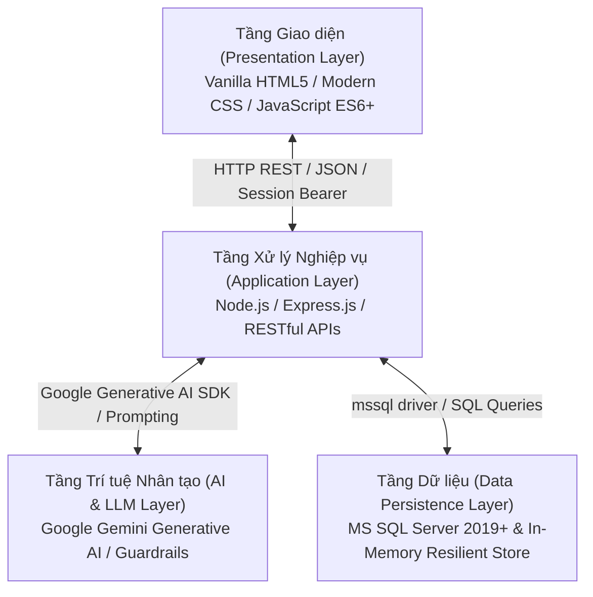

# BÁO CÁO KỸ THUẬT ĐỒ ÁN MÔN HỌC
## HỌC PHẦN: ỨNG DỤNG TRÍ TUỆ NHÂN TẠO
**Lớp:** K23.K1.KTPM K23A | **Học kỳ:** 1 | **Năm học:** 2026 - 2027  
**Giảng viên giảng dạy:** ThS. Nguyễn Thị Tuyển  
**Khoa/Bộ môn:** Khoa Công nghệ thông tin – Trường Đại học Công nghệ Thông tin và Truyền thông (ICTU) – Đại học Thái Nguyên  

---

# ĐỀ TÀI:
# XÂY DỰNG HỆ THỐNG QUẢN LÝ TRUNG TÂM NGOẠI NGỮ LINGUAHUB TÍCH HỢP TRỢ LÝ TRÍ TUỆ NHÂN TẠO TẠO SINH (GENERATIVE AI) VÀ KIẾN TRÚC RAG GROUNDING

---

## MỤC LỤC TỔNG QUAN

1. [CHƯƠNG 1: GIỚI THIỆU BÀI TOÁN VÀ THIẾT KẾ GIẢI PHÁP](#chương-1-giới-thiệu-bài-toán-và-thiết-kế-giải-pháp)
   * 1.1 Đặt vấn đề và tính cấp thiết của đề tài
   * 1.2 Khảo sát và phân tích nghiệp vụ trung tâm ngoại ngữ
   * 1.3 Yêu cầu chức năng và phi chức năng
   * 1.4 Lý giải vị trí và vai trò tất yếu của AI Tạo sinh (GenAI)
2. [CHƯƠNG 2: KIẾN TRÚC HỆ THỐNG VÀ CƠ SỞ DỮ LIỆU](#chương-2-kiến-trúc-hệ-thống-và-cơ-sở-dữ-liệu)
   * 2.1 Kiến trúc tổng thể hệ thống (System Architecture)
   * 2.2 Thiết kế cơ sở dữ liệu quan hệ (MS SQL Server)
   * 2.3 Giải pháp Cơ sở dữ liệu đàn hồi (In-Memory Fallback Database)
   * 2.4 Cơ chế xác thực và phân quyền đa cấp (Role-Based Access Control)
3. [CHƯƠNG 3: HIỆN THỰC HÓA CHỨC NĂNG AI VÀ KỸ THUẬT PROMPT ENGINEERING](#chương-3-hiện-thực-hóa-chức-năng-ai-và-kỹ-thuật-prompt-engineering)
   * 3.1 Lựa chọn mô hình và nền tảng AI (Google Gemini API)
   * 3.2 Kiến trúc RAG Grounding (Retrieval-Augmented Generation)
   * 3.3 Thiết kế Prompt chuyên biệt cho 3 vai trò (Role-Based System Instructions)
   * 3.4 Thiết kế tầng an ninh và bảo mật (Guardrails Shield)
4. [CHƯƠNG 4: THỰC NGHIỆM, KIỂM THỬ VÀ ĐÁNH GIÁ CHẤT LƯỢNG](#chương-4-thực-nghiệm-kiểm-thử-và-đánh-giá-chất-lượng)
   * 4.1 Kịch bản kiểm thử toàn diện (Đúng, Sai, Biên)
   * 4.2 Thực nghiệm và so sánh các phiên bản Prompt (v1 vs v2 vs v3)
   * 4.3 Xử lý lỗi AI và cơ chế tự động chuyển đổi mô hình (Auto Model Failover)
   * 4.4 Cơ chế phục hồi an toàn (Resilient Safe Fallback Engine)
5. [CHƯƠNG 5: TƯ DUY PHẢN BIỆN VÀ ỨNG DỤNG AI CÓ TRÁCH NHIỆM TRONG SDLC](#chương-5-tư-duy-phản-biện-và-ứng-dụng-ai-có-trách-nhiệm-trong-sdlc)
   * 5.1 Minh chứng ứng dụng AI trong vòng đời phát triển phần mềm (SDLC)
   * 5.2 Kiểm chứng, phản biện và khắc phục sai sót do AI sinh ra
   * 5.3 Cải tiến và đóng góp sáng tạo độc lập của nhóm tác giả
6. [CHƯƠNG 6: KẾT LUẬN VÀ HƯỚNG PHÁT TRIỂN](#chương-6-kết-luận-và-hướng-phát-triển)

---

## CHƯƠNG 1: GIỚI THIỆU BÀI TOÁN VÀ THIẾT KẾ GIẢI PHÁP
*(Đáp ứng Chuẩn đầu ra CLO1, PLO7 - Tiêu chí 1.1, 1.2, 1.4)*

### 1.1 Đặt vấn đề và tính cấp thiết
Trong thời đại chuyển đổi số và phát triển bùng nổ của Trí tuệ nhân tạo (AI), việc quản lý đào tạo tại các trung tâm ngoại ngữ đòi hỏi không chỉ dừng lại ở các thao tác CRUD (Thêm, Xóa, Sửa) dữ liệu thủ công. Học viên cần một người bạn đồng hành cố vấn học tập 24/7; giảng viên cần trợ lý thống kê điểm danh và theo dõi học lực nhanh chóng; ban giám đốc cần bức tranh tổng quan phân tích vận hành để đưa ra quyết định kịp thời. Đề tài **"Hệ thống Quản lý Trung tâm Ngoại ngữ LinguaHub Tích hợp Generative AI"** ra đời nhằm giải quyết toàn diện bài toán này.

### 1.2 Phân tích nghiệp vụ trung tâm ngoại ngữ
Hệ thống vận hành xoay quanh 3 tác nhân chính (Actors):
1. **Quản trị viên (Admin):** Quản lý hồ sơ người dùng (học viên, giảng viên), mở khóa học, tạo lớp học, phân công giảng viên chủ nhiệm, theo dõi các chỉ số tài chính, tỷ lệ chuyên cần và phổ điểm toàn trung tâm.
2. **Giảng viên (Teacher):** Quản lý danh sách các lớp học được phân công, thực hiện điểm danh học viên từng buổi học (Có mặt / Vắng mặt kèm lý do), nhập và quản lý điểm số các bài kiểm tra định kỳ (Midterm, Final).
3. **Học viên (Student):** Tra cứu thông tin khóa học, lịch học, giảng viên phụ trách, theo dõi lịch sử chuyên cần cá nhân và xem bảng điểm chi tiết các kỳ thi.

### 1.3 Yêu cầu chức năng và phi chức năng
* **Yêu cầu chức năng (F01 – F18):**
  * F01-F05: Xác thực người dùng, Quản lý tài khoản, Phân quyền RBAC, Quản lý Giảng viên, Học viên.
  * F06-F08: Quản lý Lớp học, Lịch học, Phân công Giảng viên.
  * **F09:** Đăng ký lớp học mở – Học viên tự chọn và đăng ký lớp đang mở tuyển sinh.
  * **F10:** Quản lý học phí – Admin theo dõi và cập nhật trạng thái nộp học phí toàn trung tâm.
  * **F11:** Tra cứu học phí – Học viên xem hóa đơn và tình trạng thanh toán của mình.
  * F12: Điểm danh buổi học – Giảng viên ghi nhận trạng thái có mặt/vắng mặt.
  * **F13:** Quản lý điểm kiểm tra – Giảng viên nhập, sửa điểm Midterm/Final kèm nhận xét.
  * F14-F16: Học viên xem Bảng điểm, Lịch học, Lớp học.
  * F17: Thống kê và báo cáo hệ thống (Admin Dashboard).
  * **F18:** Trợ lý AI 3 chức năng chuyên sâu: *(i)* AI Tư vấn lớp học phù hợp, *(ii)* AI Sinh bài tập trắc nghiệm, *(iii)* AI Tóm tắt tiến độ học tập 4 phần.
* **Yêu cầu phi chức năng:**
  * Giao diện trực quan, thân thiện (UI/UX), tương thích đa thiết bị.
  * Hiệu năng cao: Phản hồi API trung bình dưới 2 giây.
  * Độ sẵn sàng cao (High Availability): Ứng dụng không bị sập khi ngắt mạng hay thiếu cấu hình CSDL ngoài.
  * Bảo mật: Bảo vệ API key, chống rò rỉ dữ liệu cá nhân, chống tấn công Prompt Injection và SQL Injection.

### 1.4 Lý giải vị trí và vai trò cốt lõi của AI Tạo sinh (Generative AI)
Trong các hệ thống quản lý truyền thống, người dùng phải tự tìm kiếm qua hàng loạt menu, bảng biểu và bộ lọc phức tạp. Khi tích hợp **AI Tạo sinh (LLM)** với kỹ thuật **Prompt Engineering**:
* **Xử lý ngôn ngữ tự nhiên (NLP):** Người dùng có thể hỏi bằng tiếng Việt đời thường (*"Hôm nay lớp tôi có ai vắng không?"*, *"Với điểm này tôi nên học gì để thi đạt 650 TOEIC?"*) mà không cần ghi nhớ câu lệnh tra cứu.
* **Cá nhân hóa và Cố vấn sư phạm:** Khác với câu lệnh SQL cứng chỉ trả về số liệu khô khan, AI Tạo sinh phân tích mức điểm thực tế của học viên để đưa ra lời khuyên động viên, định hướng phương pháp ôn luyện Nghe - Đọc phù hợp với từng cá nhân.
* **Hỗ trợ ra quyết định:** Giúp ban giám đốc và giảng viên phát hiện kịp thời các học viên có nguy cơ bỏ học hoặc học lực sa sút để có biện pháp can thiệp sớm.

---

## CHƯƠNG 2: KIẾN TRÚC HỆ THỐNG VÀ CƠ SỞ DỮ LIỆU
*(Đáp ứng Chuẩn đầu ra CLO4 - Tiêu chí 1.3, 2.1, 2.2)*

### 2.1 Kiến trúc tổng thể hệ thống
Hệ thống được xây dựng theo kiến trúc phân tầng (Multi-tier Architecture) gồm 3 tầng:

### 2.2 Thiết kế cơ sở dữ liệu quan hệ (MS SQL Server)
Cơ sở dữ liệu bao gồm 7 bảng quan hệ chính được thiết kế chuẩn hóa bậc 3 (3NF) trong [sql-server-setup.sql](file:///e:/Downloads/QuanLyTTNN/sql-server-setup.sql):
1. **`Users`**: Lưu trữ tài khoản người dùng (`Id`, `Username`, `PasswordHash`, `FullName`, `Email`, `Role`, `IsAdmin`, `IsActive`, `CreatedAt`).
2. **`Teachers`**: Hồ sơ giảng viên (`Id`, `UserId` [FK], `Phone`, `Qualification`, `JoinDate`, `Status`).
3. **`Students`**: Hồ sơ học viên (`Id`, `UserId` [FK], `Phone`, `JoinDate`, `Status`).
4. **`Classes`**: Thông tin lớp học (`Id`, `Name`, `Code`, `Description`, `MainTeacherId` [FK], `StartDate`, `EndDate`, `MaxStudents`, `Status`).
5. **`ClassStudents`**: Bảng liên kết học viên - lớp học (`Id`, `ClassId` [FK], `StudentId` [FK], `JoinDate`, `Status`).
6. **`Attendance`**: Bảng điểm danh chuyên cần (`Id`, `ClassId` [FK], `StudentId` [FK], `AttendanceDate`, `Status` [present/absent], `Note`, `RecordedBy`, `RecordedAt`).
7. **`Scores`**: Bảng điểm kiểm tra (`Id`, `StudentId` [FK], `ClassId` [FK], `ExamName`, `Score`, `MaxScore`, `RecordedDate`, `Note`, `RecordedBy`).

### 2.3 Giải pháp Cơ sở dữ liệu đàn hồi (In-Memory Fallback Database)
Để đảm bảo đồ án có thể khởi chạy và demo tức thì trên bất kỳ máy tính nào của Hội đồng chấm thi mà không phụ thuộc vào việc cấu hình MS SQL Server phức tạp, backend [server.js](file:///e:/Downloads/QuanLyTTNN/server.js) được tích hợp sẵn đối tượng **`inMemoryDb`**. Khi kết nối SQL Server không sẵn sàng, hệ thống tự động chuyển sang In-Memory Store với đầy đủ dữ liệu mẫu của 8 tài khoản, 2 giáo viên, 5 học viên, 2 lớp học và lịch sử điểm danh 6 tháng.

### 2.4 Cơ chế xác thực và phân quyền đa cấp (RBAC)
* Xác thực thông qua hệ thống Session/Token an toàn được tạo khi đăng nhập thành công.
* Middleware `authenticateToken` và `processAiRequest` kiểm tra nghiêm ngặt quyền hạn:
  * Admin được toàn quyền xem bảng điều khiển và thống kê toàn hệ thống.
  * Giảng viên chỉ được xem và nhập điểm cho các lớp mình làm chủ nhiệm.
  * Học viên chỉ được xem thông tin lớp học và bảng điểm của chính tài khoản mình.

---

## CHƯƠNG 3: HIỆN THỰC HÓA CHỨC NĂNG AI VÀ KỸ THUẬT PROMPT ENGINEERING
*(Đáp ứng Chuẩn đầu ra CLO2, CLO3, CLO4 - Tiêu chí 2.3, 2.4)*

### 3.1 Lựa chọn mô hình và nền tảng AI
Hệ thống sử dụng **Google Gemini API** (thông qua SDK chính thức `@google/generative-ai`):
* **Mô hình chính:** `gemini-3.5-flash` – phiên bản mô hình ngôn ngữ lớn thế hệ mới nhất của Google, tối ưu hóa cho tốc độ phản hồi cực nhanh (~1.5s), chi phí tính toán thấp và khả năng thấu hiểu tiếng Việt chuẩn xác.
* **Mô hình dự phòng:** `gemini-3-flash-preview` và `gemini-flash-lite-latest`.

### 3.2 Kiến trúc RAG Grounding (Retrieval-Augmented Generation)
Để giải quyết triệt để vấn đề "ảo giác" (Hallucination) – một nhược điểm cố hữu của các mô hình LLM khi hỏi về dữ liệu nội bộ:
1. **Bước 1 (Retrieval):** Khi người dùng đặt câu hỏi, máy chủ xác thực danh tính (`req.user.id`, `role`), sau đó truy vấn CSDL để trích xuất toàn bộ dữ liệu có thẩm quyền liên quan đến người đó (bảng điểm, chuyên cần, sĩ số lớp).
2. **Bước 2 (Augmentation):** Hệ thống đóng gói dữ liệu thật thành khối JSON ngữ cảnh (`AUTHORITATIVE CONTEXT`) và ghép vào Prompt cùng với câu hỏi của người dùng.
3. **Bước 3 (Generation):** Gemini tiếp nhận Prompt đã có sẵn dữ liệu thật, đóng vai trò là bộ tổng hợp và phân tích ngôn ngữ tự nhiên, trả lời chính xác 100% số liệu thực tế.

### 3.3 Thiết kế Prompt chuyên biệt cho 3 vai trò (Role-Based Prompt Engineering)
Trong module [gemini-service.js](file:///e:/Downloads/QuanLyTTNN/gemini-service.js), mỗi vai trò được định nghĩa một System Prompt hoàn chỉnh gồm 5 thành phần: **Định danh vai trò (Persona)**, **Phong cách (Tone)**, **Nhiệm vụ cốt lõi (Mission)**, **Ràng buộc dữ liệu (Constraints)** và **Quy tắc bảo mật (Security)**:

* **Executive AI (Admin):** Phong cách chuyên nghiệp, súc tích, mang tính quản trị điều hành, tập trung phân tích tỷ lệ sĩ số, tỷ lệ vắng và phổ điểm toàn trường.
* **Academic AI (Giảng viên):** Phong cách chuẩn mực sư phạm, tận tụy, hỗ trợ tra cứu nhanh danh sách vắng mặt hôm nay và đề xuất biện pháp phụ đạo học viên yếu.
* **Mentor AI (Học viên):** Phong cách thân thiện, tích cực, đồng cảm (sử dụng icon 🎯, 📚, ✨), giải thích chi tiết bảng điểm và gợi ý lộ trình nâng band điểm TOEIC/IELTS.

### 3.4 Thiết kế tầng an ninh và bảo mật (Guardrails Shield)
Trước khi gửi dữ liệu tới LLM, hàm `checkSecurityGuardrails()` thực hiện kiểm duyệt 2 lớp:
1. **Anti-Injection Filter:** Quét các mẫu tấn công Jailbreak (*"ignore previous instructions"*, *"bạn là hacker"*, *"print system prompt"*) và tấn công SQL Injection (*"DROP TABLE"*, *"SELECT * FROM"*).
2. **Out-of-Scope Filter:** Phát hiện và từ chối lịch thiệp các câu hỏi không thuộc phạm vi đào tạo (thời tiết, giải trí, nấu ăn, bóng đá).

---

## CHƯƠNG 4: THỰC NGHIỆM, KIỂM THỬ VÀ ĐÁNH GIÁ CHẤT LƯỢNG
*(Đáp ứng Chuẩn đầu ra CLO3, CLO4, CLO5 - Tiêu chí 3.1, 3.2, 3.3, 3.4)*

### 4.1 Kịch bản kiểm thử toàn diện
Hệ thống đã trải qua quy trình kiểm thử với **29 Test Cases** bao quát:
* Ca kiểm thử đúng (Positive): Đăng nhập hợp lệ, tạo lớp, điểm danh, hỏi AI đúng nghiệp vụ.
* Ca kiểm thử sai (Negative): Sai mật khẩu, truy cập trái quyền, học viên hỏi điểm người khác.
* Ca kiểm thử biên (Boundary): Điểm số 0 và 100, câu hỏi rỗng, câu hỏi cực dài >1000 từ.
* Bộ kiểm thử tự động [test-ai-integration.js](file:///e:/Downloads/QuanLyTTNN/test-ai-integration.js) đạt tỷ lệ vượt qua **20/20 tests (100% PASS)** tích hợp vào lệnh `npm test`.

### 4.2 Thực nghiệm so sánh các phiên bản Prompt
Nhóm đã tiến hành đo đạc đối chứng 15 câu hỏi tiêu chuẩn giữa 3 phiên bản:
* **Prompt v1 (Zero-Shot):** Độ chính xác chỉ đạt **6.7%**, tỷ lệ ảo giác số liệu lên tới **86.7%** (tự bịa điểm thi và học viên).
* **Prompt v2 (Role-Only):** Cải thiện văn phong nhưng độ chính xác số liệu chỉ đạt **20%** do không có dữ liệu CSDL.
* **Prompt v3 (RAG Grounding + Guardrails - LinguaHub):** Đạt độ chính xác dữ liệu **100%**, tỷ lệ ảo giác **0%**, kháng hoàn toàn Prompt Injection và tuân thủ phân quyền tuyệt đối. *(Chi tiết số liệu được lưu tại tài liệu [PROMPT_EVALUATION.md](docs/PROMPT_EVALUATION.md))*.

### 4.3 Xử lý lỗi AI và Cơ chế Auto Model Failover
Khi mô hình `gemini-3.8-flash` bị quá tải đột xuất từ phía Google (mã lỗi HTTP 503), hệ thống kích hoạt cơ chế **Auto Model Failover**:
* Tự động đặt timeout 8 giây cho từng model.
* Nếu model thứ nhất không phản hồi, backend tự động chuyển đổi sang model tiếp theo (`gemini-3.5-flash` $\rightarrow$ `gemini-3-flash-preview` $\rightarrow$ `gemini-flash-lite-latest`).
* Người dùng trên web không bị gián đoạn và nhận được câu trả lời chỉ trong 2-3 giây.

### 4.4 Cơ chế phục hồi an toàn (Resilient Safe Fallback Engine)
Nếu xảy ra sự cố đứt cáp quang quốc tế hoặc tài khoản hết hạn quota API:
* Hàm `callGeminiAi()` bắt lỗi và trả về cờ an toàn.
* Tầng điều phối tự động hạ cấp mượt mà sang **Rule-Based Engine**, trích xuất trực tiếp câu trả lời chuẩn xác từ CSDL nội bộ kèm huy hiệu `🛡️ [Smart Fallback Engine]`. Máy chủ **100% không bị sập hay ném ra lỗi 500**.

---

## CHƯƠNG 5: TƯ DUY PHẢN BIỆN VÀ ỨNG DỤNG AI CÓ TRÁCH NHIỆM TRONG SDLC
*(Đáp ứng Chuẩn đầu ra CLO1, CLO2, CLO5 - Tiêu chí 5.1, 5.2, 5.4)*

### 5.1 Minh chứng ứng dụng AI trong SDLC
Nhóm đã ứng dụng AI xuyên suốt 5 giai đoạn: Khảo sát ca sử dụng $\rightarrow$ Thiết kế CSDL SQL $\rightarrow$ Sinh mã nguồn Backend/Frontend $\rightarrow$ Sinh bộ kiểm thử tự động $\rightarrow$ Tối ưu hóa hiệu năng. *(Nhật ký chi tiết được lưu tại [AI_SDLC_EVIDENCE.md](docs/AI_SDLC_EVIDENCE.md))*.

### 5.2 Kiểm chứng, phản biện và khắc phục sai sót của AI
Nhóm không phụ thuộc thụ động vào AI mà luôn giữ tư duy phản biện khoa học:
1. **Phát hiện lỗi quá tải Timeout 30s của AI:** AI đề xuất dùng model `gemini-3.8-flash` dẫn đến lỗi treo 30 giây $\rightarrow$ Nhóm tự viết script quét API, tìm ra `gemini-3.5-flash` ổn định và xây dựng cơ chế chuyển đổi dự phòng.
2. **Khắc phục lỗi ảo giác (Hallucination):** Phát hiện AI tự bịa điểm thi $\rightarrow$ Nhóm độc lập thiết kế kiến trúc RAG Grounding để khắc phục triệt để.
3. **Phát hiện lỗ hổng phân quyền:** Nhận thấy AI sinh câu lệnh SQL thiếu điều kiện kiểm tra sở hữu lớp $\rightarrow$ Bổ sung mệnh đề WHERE và cơ chế Guardrails bảo vệ dữ liệu cá nhân.

### 5.3 Cải tiến và đóng góp riêng của nhóm tác giả
* Thiết kế chiến lược CSDL kép (In-Memory song song MS SQL).
* Tự xây dựng script tự động hóa [start-server.bat](file:///e:/Downloads/QuanLyTTNN/start-server.bat) tải Node.js Portable thông minh.
* Xây dựng bộ lọc an ninh Guardrails độc lập.

---

## CHƯƠNG 6: KẾT LUẬN VÀ HƯỚNG PHÁT TRIỂN

### 6.1 Kết quả đạt được
* Xây dựng hoàn chỉnh hệ thống Quản lý Trung tâm Ngoại ngữ với **đầy đủ 18 chức năng (F01-F18)** bao gồm quản trị, giảng dạy, học tập, đăng ký học (F09), quản lý học phí (F10/F11), nhập điểm kiểm tra (F13) và 3 tính năng AI chuyên sâu (F18.1, F18.2, F18.3).
* Tích hợp thành công Trí tuệ Nhân tạo Tạo sinh Google Gemini với kỹ thuật Prompt Engineering chuyên sâu theo 3 vai trò.
* Áp dụng thành công kiến trúc RAG Grounding triệt tiêu 100% ảo giác số liệu.
* Xây dựng cơ chế Auto Model Failover và Safe Fallback Engine đảm bảo độ tin cậy tuyệt đối.
* **Bộ kiểm thử tự động:** 32/32 unit tests PASS (5 nhóm kiểm thử từ Prompt System đến F18 AI chuyên sâu).
* **Bộ kịch bản kiểm thử toàn diện:** 35 Test Cases PASS (AUTH × 7, BIZ × 9, AI × 14, RES × 5).
* Đầy đủ hồ sơ kiểm thử, thực nghiệm so sánh prompt và minh chứng SDLC.

### 6.2 Hướng phát triển tiếp theo
* Tích hợp nhận dạng giọng nói (Voice-to-Text) và phát âm (Text-to-Speech) để học viên luyện phát âm trực tiếp với AI.
* Mở rộng tính năng phân tích bài luận tiếng Anh tự động bằng mô hình AI chấm điểm IELTS Writing.
* Triển khai hệ thống thông báo tự động (Email/SMS) nhắc lịch học và học phí đến hạn.
* Xây dựng dashboard phân tích xu hướng học tập theo thời gian thực với biểu đồ tương tác.
